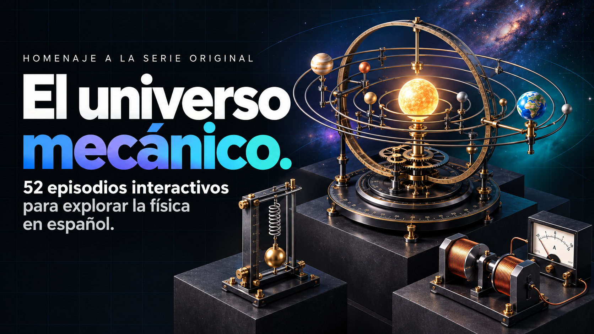

# Homenaje a «El universo mecánico»



Índice de los 52 episodios de la colección, con títulos en español. Los 52 episodios están disponibles como explicaciones interactivas.

El índice y los episodios funcionan sin servidor ni conexión. La interfaz se abre en tema oscuro, permite cambiar al tema claro y se adapta a pantallas pequeñas. El índice respeta la preferencia de tema que hayas guardado.

Sitio: <https://josoroma.github.io/Mechanical-Universe/>

## Contenido

- [Actualizar el índice](#actualizar-el-índice)
- [Temas de la colección](#temas-de-la-colección)
- [GitHub Pages](#github-pages)
- [Prompts utilizados en el loop](#prompts-utilizados-en-el-loop)

## Actualizar el índice

Con Node.js 22 o posterior, modifica los títulos o las carpetas en `episodes.mjs` y ejecuta:

```sh
node build-index.mjs
```

Un episodio solo recibe un enlace cuando tiene una carpeta asignada y existe su `index.html`. El generador valida los 52 títulos y todos los destinos. `index.css` contiene los estilos; el HTML generado integra los estilos y el selector de tema.

Cada carpeta de episodio conserva su código fuente, documentación, pruebas y licencia del kit Anatomy. Las capturas de revisión y los registros locales se excluyen de Git.

## Temas de la colección

`theme.css` define la paleta de la interfaz, inspirada en Luma: azul, violeta y turquesa, superficies claras o negras y grises, títulos con degradado y tarjetas redondeadas. El tema oscuro conserva la cuadrícula y los difuminados suaves. Las tablas tienen espacio interior y desplazamiento horizontal dentro de su tarjeta cuando hace falta; las secciones seleccionadas se distinguen por el fondo y el texto, sin una línea inferior. Conserva colores distintos para las magnitudes físicas. Los controles de tema de cada página siguen seleccionando la versión clara u oscura.

`machine-materials.css` define por separado el acabado de los instrumentos: grafito, acero oscuro, vidrio ahumado y escalas claras en ambos temas. El cobre y los colores que identifican elementos físicos conservan su función; los carros A y B tienen pequeñas plataformas azules y turquesas. Las caras y las juntas se aclaran ligeramente en el tema oscuro para conservar el relieve.

`theme.mjs` define `DEFAULT_THEME` como oscuro e integra estos estilos al final de cada HTML completo. No hay fuentes, bibliotecas ni hojas de estilo que deban descargarse. Los archivos `page.html` de algunos episodios son plantillas parciales; reciben el tema cuando su generador produce las páginas completas. Las rutas `episode-N-dark.html` siguen disponibles.

[AGENTS.md](AGENTS.md) documenta el idioma, la paleta, los materiales, el espacio de las tablas y las reglas de selección para conservar este diseño en futuros episodios.

Para actualizar las 105 páginas publicadas después de modificar el tema:

```sh
node build-all.mjs
```

También puedes ejecutar el `build.mjs` de un episodio. Mantén `theme.css`, `machine-materials.css`, `theme.mjs` y `playback.js` en la carpeta superior al copiar el código fuente para regenerarlo. Los HTML finales son autónomos.

Para comprobar el cambio de tema de cada página, el contraste de la paleta y los tamaños de 1440 y 390 px, con Chrome instalado:

```sh
node tests/themes.mjs
```

La prueba también comprueba que se muestran las máquinas y que los textos principales no se recortan. Guarda cuatro hojas de revisión en `shots/themes/`. Puedes indicar otro navegador Chromium mediante `CHROME_PATH`.

`node tests/playback.mjs` comprueba la recuperación del reloj al navegar con Atrás, restaurar una página y volver de una pestaña oculta, a 1440 y 390 px. También verifica que no se dupliquen los relojes y que los episodios 17–52 conserven la pausa manual y puedan repetir el recorrido al terminar.

## GitHub Pages

El sitio es estático y se publica desde la raíz de la rama `main`. `.nojekyll` permite servir directamente los archivos. Los enlaces de los episodios son relativos y funcionan dentro de `/Mechanical-Universe/`.

## Prompts utilizados en el loop

Estas son las 52 instrucciones originales utilizadas para crear los episodios. Se conservan en inglés tal como se solicitaron. Para cada episodio también se pidió contenido en español y una carpeta de salida dentro de `mechanical-universe/`.

1. `/anatomy Episode 1: Introduction – a grand orrery showing the shift from Ptolemaic to Copernican to Newtonian universe, interactive`.

2. `/anatomy Episode 2: The Law of Falling Bodies – Galileo’s inclined plane and simultaneous drop apparatus, interactive`.

3. `/anatomy Episode 3: Derivatives – a mechanical differential analyzer or rolling-ball slope machine that computes rates of change, interactive`.

4. `/anatomy Episode 4: Inertia – Galileo’s ship thought-experiment as a rolling cart with hanging pendulum, interactive`.

5. `/anatomy Episode 5: Vectors – a mechanical vector-addition machine with sliding arms and parallelogram linkages, interactive`.

6. `/anatomy Episode 6: Newton’s Laws – Atwood’s machine and a force-table apparatus demonstrating F = ma, interactive`.

7. `/anatomy Episode 7: Integration – a mechanical integrator (planimeter or disk-and-wheel integrator) that accumulates area under a curve, interactive`.

8. `/anatomy Episode 8: The Apple and the Moon – Newton’s cannonball thought-experiment on a mountain with adjustable velocity, interactive`.

9. `/anatomy Episode 9: Moving in Circles – a conical pendulum and rotating turntable demonstrating centripetal force, interactive`.

10. `/anatomy Episode 10: Fundamental Forces – a mechanical balance comparing gravitational and electrostatic forces side-by-side, interactive`.

11. `/anatomy Episode 11: Gravity, Electricity, Magnetism – torsion balance (Cavendish-style) and early electrostatic generator, interactive`.

12. `/anatomy Episode 12: The Millikan Experiment – Millikan oil-drop apparatus with atomizer, microscope, and adjustable electric field, interactive`.

13. `/anatomy Episode 13: Conservation of Energy – a roller-coaster track with moving car and height/velocity readout, interactive`.

14. `/anatomy Episode 14: Potential Energy – a gravitational potential well model with rolling balls and spring-potential analogy, interactive`.

15. `/anatomy Episode 15: Conservation of Momentum – air-track collision apparatus with gliders and spring bumpers, interactive`.

16. `/anatomy Episode 16: Harmonic Motion – mass-spring system and simple pendulum side-by-side with phase portrait, interactive`.

17. `/anatomy Episode 17: Resonance – driven harmonic oscillator with variable driving frequency and amplitude buildup, interactive`.

18. `/anatomy Episode 18: Waves – wave machine (transverse and longitudinal) with adjustable tension and frequency, interactive`.

19. `/anatomy Episode 19: Angular Momentum – rotating platform with hand weights and bicycle-wheel gyroscope, interactive`.

20. `/anatomy Episode 20: Torques and Gyroscopes – precision gyroscope on gimbals showing precession and nutation, interactive`.

21. `/anatomy Episode 21: Kepler’s Three Laws – mechanical orrery with elliptical orbits and sweeping radius vector, interactive`.

22. `/anatomy Episode 22: The Kepler Problem – inverse-square force apparatus that produces elliptical orbits (string or magnetic version), interactive`.

23. `/anatomy Episode 23: Energy and Eccentricity – orbital energy diagram realized as a physical track with different eccentricities, interactive`.

24. `/anatomy Episode 24: Navigating in Space – Hohmann transfer orbit model with two planets and transfer ellipse, interactive`.

25. `/anatomy Episode 25: From Kepler to Einstein – comparison of Newtonian and relativistic orbit precession (Mercury), interactive`.

26. `/anatomy Episode 26: Harmony of the Spheres – Kepler’s nested Platonic solids and musical ratios as a mechanical music-of-the-spheres machine, interactive`.

27. `/anatomy Episode 27: Beyond the Mechanical Universe – transition machine from classical gears to electromagnetic coils and quantum dice, interactive`.

28. `/anatomy Episode 28: Static Electricity – Wimshurst machine or Van de Graaff generator with pith balls and Leyden jars, interactive`.

29. `/anatomy Episode 29: The Electric Field – Faraday cage and field-line mapping apparatus with test charge, interactive`.

30. `/anatomy Episode 30: Capacitance and Potential – parallel-plate capacitor with variable plate separation and dielectric, interactive`.

31. `/anatomy Episode 31: Voltage, Energy and Force – electrostatic voltmeter and force-between-plates demonstration, interactive`.

32. `/anatomy Episode 32: The Electric Battery – Voltaic pile and early Daniell cell with visible ion flow, interactive`.

33. `/anatomy Episode 33: Electric Circuits – series/parallel resistor board with ammeters, voltmeters and glowing lamps, interactive`.

34. `/anatomy Episode 34: Magnetism – bar magnets, compass array, and Oersted’s current-carrying wire experiment, interactive`.

35. `/anatomy Episode 35: The Magnetic Field – solenoid and electromagnet with iron filings or Hall probe readout, interactive`.

36. `/anatomy Episode 36: Vector Fields and Hydrodynamics – fluid flow table with sources, sinks and vortices mapped to electric/magnetic fields, interactive`.

37. `/anatomy Episode 37: Electromagnetic Induction – Faraday’s disk and sliding-bar generator with induced current meter, interactive`.

38. `/anatomy Episode 38: Alternating Current – simple AC generator with rotating coil and oscilloscope-style readout, interactive`.

39. `/anatomy Episode 39: Maxwell’s Equations – mechanical model of displacement current and electromagnetic wave generation, interactive`.

40. `/anatomy Episode 40: Optics – optical bench with lenses, mirrors, prism and ray-tracing, interactive`.

41. `/anatomy Episode 41: The Michelson-Morley Experiment – Michelson interferometer on a rotating stone slab, interactive`.

42. `/anatomy Episode 42: The Lorentz Transformation – mechanical spacetime diagram with light clocks and length-contraction rods, interactive`.

43. `/anatomy Episode 43: Velocity and Time – light-clock thought experiment realized as a physical bouncing-light apparatus on a moving cart, interactive`.

44. `/anatomy Episode 44: Energy, Momentum and Mass – relativistic mass-increase demonstration with particle accelerator analogy, interactive`.

45. `/anatomy Episode 45: Temperature and the Gas Law – kinetic-theory model with bouncing balls in a piston chamber, interactive`.

46. `/anatomy Episode 46: Engine of Nature – Carnot engine (or Stirling engine) with heat reservoirs and efficiency readout, interactive`.

47. `/anatomy Episode 47: Entropy – mechanical model of mixing and irreversible processes (two gases or shuffled cards), interactive`.

48. `/anatomy Episode 48: Low Temperatures – liquefaction of air apparatus or adiabatic demagnetization cooler, interactive`.

49. `/anatomy Episode 49: The Atom – Rutherford scattering apparatus (gold-foil experiment) with alpha-particle detector, interactive`.

50. `/anatomy Episode 50: Particles and Waves – double-slit apparatus that can switch between particle and wave behavior, interactive`.

51. `/anatomy Episode 51: Atoms to Quarks – particle accelerator cascade from atoms to nuclei to quarks, interactive`.

52. `/anatomy Episode 52: The Quantum Mechanical Universe – quantum potential well with tunneling barrier and probability clouds, interactive`.

Un homenaje a [The Mechanical Universe… and Beyond](https://www.its.caltech.edu/~tmu/), la serie educativa de física de Caltech e INTELECOM.

https://josoroma.github.io/Mechanical-Universe/
